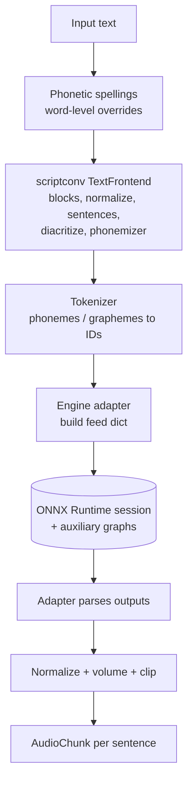

# Architecture

<!-- agent-hint
covers: how text becomes audio in phoonnx, which component owns each step, and where the extension points are
source: phoonnx/voice.py:TTSVoice (prepare, render, synthesize), phoonnx/encoders.py, phoonnx/tokenizer.py:TTSTokenizer, phoonnx/engines/__init__.py:detect_engine, phoonnx/engines/vocoders/, phoonnx/model_manager.py, phoonnx/audio.py:write_wav
generated: no
verify: python -I -c "from phoonnx.engines import detect_engine; print([type(detect_engine(config={'engine': e})).__name__ for e in ('phoonnx', 'piper', 'transformers')])" (prints VitsAdapter three times)
see: engines.md, phonemizers.md, vocoders.md, api.md
-->

This page explains how a string of text becomes audio inside phoonnx, for contributors and advanced users.

It names the component that owns each step and the place to plug in a phonemizer, an
engine or a vocoder.

## The synthesis pipeline

`TTSVoice` (in `phoonnx/voice.py`) is architecture-agnostic: it drives the text→tokens
front-end and delegates everything ONNX-specific to an **engine adapter**. The same class
serves a single-graph VITS voice and a multi-graph flow-matching voice without changes.

`TTSVoice.synthesize` is two public steps. `TTSVoice.prepare` does steps 1 to 3 and yields
one `Utterance` (text, symbols, token IDs, side streams, params) for each engine call.
`TTSVoice.render` does steps 4 and 5 for one `Utterance` and returns one `AudioChunk`.
`synthesize` calls `render` on each utterance that `prepare` yields, one at a time. Thus the
first sentence becomes audio before the second sentence is phonemized. Step by step:

1. **Phonetic spellings** — when `phonetic_spellings` is set, word-level
   replacements loaded from the voice's `locale/<lang>/phonetic_spellings.txt` are applied
   to the raw text. A `<lang>.txt` file in `$PHOONNX_PHONETIC_SPELLINGS_DIR` adds to them
   and wins over them.
2. **Text frontend** — `TTSVoice.frontend` is a scriptconv `TextFrontend` over the voice's
   [phonemizer](phonemizers.md). It runs a fixed order: it splits out inline `[[...]]`
   blocks, normalizes the whole text, splits it into sentences, adds diacritics when
   the voice or the call asks for them, and then runs the phonemizer. The symbols of a block
   go into the output as written. A per-call `SynthesisConfig.stages.diacritize` wins; when it
   is unset, the voice config decides, so an undiacritized model is never force-diacritized.
   An engine that reads text instead of phonemes gets the text from `TextFrontend.prepare`,
   after the same normalization and diacritics as a phoneme voice.
   Some phonemizers give a value per symbol beside the symbols, in the `streams` of each
   segment from `phonemize_segments`: Shami a language ID, dizione a stress value. Each reaches the
   engine as the request field of the same name (`language_ids`, `stress`), one value per
   phoneme ID.
3. **Encode** — the voice's encoder (`TTSVoice.encoder`, from `phoonnx/encoders.py`)
   turns the frontend output into integer IDs. The adapter builds it in `make_encoder`. For
   a phoneme or grapheme engine it is a `SymbolEncoder`: the `TTSTokenizer` maps
   phonemes/characters to IDs using the voice's `phoneme_id_map`, inserting
   blank/pad/bos/eos tokens per the voice config. For a text-token engine (Chatterbox) it
   is a `TextEncoder`: Chatterbox overrides `make_encoder`, and its BPE tokenizer
   tokenizes each normalized frontend chunk. Chatterbox does not call its `encode_text`
   on this path.
4. **Adapter synthesize** — `render` merges the parameters (adapter defaults → the
   `inference` scales of the voice config → the voice's `engine_params` → the scales of
   the per-call `SynthesisConfig` → its `extra`, where a later one wins), builds an
   `AdapterSynthesisRequest`, and hands it to the engine adapter, which runs the ONNX
   session(s) and returns a float32 waveform.
5. **Post-process** — a waveform that holds NaN or infinite samples raises
   `NonFiniteAudioError`. Otherwise the waveform is optionally peak-normalized or brought
   to the `audio.target_loudness`, volume-scaled, and clipped to `[-1, 1]`. Voice conversion and super-resolution run last when the call asks for
   them. The result is one `AudioChunk` per utterance. `phoonnx.audio.write_wav` writes a
   stream of chunks to a WAV file. `synthesize_wav` and `synthesize_ssml_wav` use it.

Text normalization of numbers, dates and units (`text2spoken.normalize`) runs in the text
frontend and during dataset [preprocessing](training/preprocess.md), before diacritization in
both, so training text matches inference. Contractions stay as written. Every voice runs the step, text-token and grapheme engines included. The step is
skipped only for a phonemizer that names `normalize` in its `owned_stages`, because that
phonemizer normalizes its own input. Individual phonemizer backends may also clean their own input.

## Where the extension points live

| Concern | Owner | Registry / hook |
|---|---|---|
| Text → phonemes | `scriptconv.frontend.TextFrontend` and `scriptconv.phonemizers` (delegated) | `TTSVoice.frontend`; the phonemizer comes from scriptconv's registry by `phoneme_type` |
| Phonemes → IDs | `phoonnx/tokenizer.py` | `TTSTokenizer` built from the voice config |
| IDs → audio (ONNX I/O) | `phoonnx/engines/` | `register_engine(name, adapter_cls, detect_priority=...)` |
| Mel → waveform (two-stage) | `phoonnx/engines/vocoders/` | vocoder registry, selected by `vocoder_type` |
| Voice discovery / download | `phoonnx/model_manager.py` | `TTSModelManager`, bundled `voice_index/*.json` |

## Engine selection

At load time `TTSVoice` resolves an adapter in this order (`voice.py` + `engines/__init__.py`):

1. If the voice config names a registered engine in `engine`, phoonnx uses that adapter.
   The format names `phoonnx`, `piper`, `mimic3`, `coqui` and `transformers` are not
   registered engines. Detection, or the fallback in step 3, gives these voices the **VITS**
   adapter.
2. Otherwise `detect_engine()` probes registered adapters in ascending `detect_priority`
   (lower is checked first) and returns the first whose `detect()` matches the config and
   ONNX session.
3. If nothing matches, phoonnx logs a warning and uses the VITS adapter.

[Engines](engines.md) describes the adapter registry. The
[Configuration reference](configuration.md#engine-enum) lists every member of the `Engine`
enum, and it describes how phoonnx detects the Piper, Mimic3, Coqui and Transformers config
shapes.

## Two-stage engines and auxiliary graphs

Single-stage engines (VITS and its Piper/Mimic3/Coqui variants) emit a waveform directly.
Two-stage engines (Matcha, GlowTTS, MixerTTS, FastPitch) emit a mel spectrogram and pair
with a separate **vocoder** ONNX graph. Cloning and multi-graph engines load further
auxiliary graphs — speaker encoders (YourTTS), style encoders (StyleTTS2), text/flow decoders
(ZipVoice, F5-TTS), the four-graph codec-LM split (Chatterbox), or SuperTonic's four
flow-matching graphs. The voice manager
downloads these alongside the primary model and injects their local paths into
`engine_params`; every auxiliary session runs on the same execution providers as the voice.
See [Vocoders](vocoders.md) and the per-engine pages under
[training/engines/](training/engines/matcha.md).

---

[Docs index](index.md) · Previous: [Indic Parler-TTS](training/engines/indic_parler.md) · Next: [Engine architecture](engines.md)
