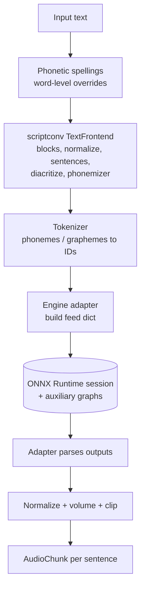

# Architecture

<!-- agent-hint
covers: how text becomes audio in phoonnx, which component owns each step, and where the extension points are
source: phoonnx/voice.py:TTSVoice (prepare, render, synthesize, frontend, _level), phoonnx/config.py:voice_frontend, phoonnx/encoders.py, phoonnx/tokenizer.py:TTSTokenizer, phoonnx/engines/__init__.py:detect_engine, phoonnx/engines/vocoders/, phoonnx/model_manager.py, phoonnx/audio.py:write_wav
generated: no
verify: .venv/bin/python -m doctest -o ELLIPSIS -o NORMALIZE_WHITESPACE docs/architecture.md
see: engines.md, phonemizers.md, vocoders.md, api.md
-->

This page explains how a string of text becomes audio inside phoonnx. It is for contributors and advanced users, and it names the component that owns each step and the place to add a phonemizer, an engine or a vocoder.

## The synthesis pipeline

`TTSVoice` in `phoonnx/voice.py` runs the text front end and gives everything that is specific to one ONNX model to an engine adapter. The same class serves a VITS voice with one graph and a flow-matching voice with many graphs.



`TTSVoice.synthesize` has two public steps. `TTSVoice.prepare` does steps 1 to 3 below. It yields one `Utterance` for each engine call, with the text, the symbols, the token ids, the side streams and the parameters. `TTSVoice.render` does steps 4 and 5 for one `Utterance` and returns one `AudioChunk`. `synthesize` renders each utterance when `prepare` yields it, so the first sentence becomes audio before the second sentence is phonemized.

1. **Phonetic spellings.** When `SynthesisConfig.phonetic_spellings` is set, phoonnx replaces words in the raw text with the entries of `locale/<lang>/phonetic_spellings.txt` of the voice. A `<lang>.txt` file in the directory that `PHOONNX_PHONETIC_SPELLINGS_DIR` names adds entries, and its entries win.
2. **Text front end.** `TTSVoice.frontend` is a scriptconv `TextFrontend` over the [phonemizer](phonemizers.md) of the voice. It runs a fixed order. It splits out inline `[[...]]` blocks, normalizes the whole text, applies the text casing of the voice, and splits the text into sentences. For each sentence, it adds diacritics when the voice or the call asks for them, and then runs the phonemizer. The symbols of a block go into the output as written. A `SynthesisConfig.stages.diacritize` value on the call wins. When the call does not set it, the voice config decides, so phoonnx never adds diacritics for a model that was trained without them. An engine that reads text, not phonemes, gets the text from `TextFrontend.prepare`, after the same normalization and diacritics.
3. **Encode.** The encoder of the voice (`TTSVoice.encoder`, from `phoonnx/encoders.py`) turns the front end output into integer ids. The adapter builds it in `make_encoder`. For a phoneme or grapheme engine, it is a `SymbolEncoder`: the `TTSTokenizer` maps each symbol to an id with the `phoneme_id_map` of the voice, and adds the blank, pad, start and end tokens that the voice config asks for. For a text-token engine, such as Chatterbox, it is a `TextEncoder`: Chatterbox overrides `make_encoder`, and its BPE tokenizer reads each normalized chunk of the front end.
4. **Adapter synthesis.** `render` merges the engine parameters, and a later source wins: the adapter defaults, the `inference` scales of the voice config, the `engine_params` of the voice, the scales of the `SynthesisConfig` of the call, and its `extra`. It builds an `AdapterSynthesisRequest` and gives it to the engine adapter. The adapter runs the ONNX sessions and returns a float32 waveform.
5. **Post-processing.** A waveform with NaN or infinite samples raises `NonFiniteAudioError`. phoonnx then peak-normalizes the waveform or brings it to the `audio.target_loudness`, when the call asks for it, applies `audio.volume`, and clips it to `[-1, 1]`. Voice conversion and super-resolution run last, when the call asks for them. The result is one `AudioChunk` per utterance. `phoonnx.audio.write_wav` writes a stream of chunks to a WAV file, and `synthesize_wav` and `synthesize_ssml_wav` use it.

Some phonemizers give a value for each symbol, beside the symbols, in the `streams` of each segment from `phonemize_segments`. The Shami phonemizer gives a language id, and dizione gives a stress value. Each stream reaches the engine as the request field of the same name, with one value per phoneme id:

```python
>>> from phoonnx.encoders import SIDE_STREAMS
>>> SIDE_STREAMS
('language_ids', 'stress')

```

The normalization of numbers, dates and units is `text2spoken.normalize`. It runs in the text front end of every voice, text-token and grapheme engines included, before diacritization. Dataset [preprocessing](training/preprocess.md) builds its front end with the same function, `phoonnx.config.voice_frontend`, so training text matches inference text. A phonemizer that names `normalize` in its `owned_stages` normalizes its own input, and the front end skips the step for it.

## Engine selection

When a voice loads, `TTSVoice` selects an adapter with `detect_engine()` in `phoonnx/engines/__init__.py`, in this order:

1. If the voice config names a registered engine in `engine`, phoonnx uses that adapter.
2. If not, `detect_engine()` asks the registered adapters in order of `detect_priority`, lowest first. It returns the first adapter whose `detect()` accepts the config and the ONNX session.
3. If no adapter accepts, phoonnx logs a warning and uses the VITS adapter.

The format names `phoonnx`, `piper`, `mimic3`, `coqui` and `transformers` are not registered engines. These voices get the VITS adapter from detection, or from the fallback in step 3:

```python
>>> from phoonnx.engines import detect_engine, list_engines
>>> formats = ("phoonnx", "piper", "mimic3", "coqui", "transformers")
>>> [name in list_engines() for name in formats]
[False, False, False, False, False]
>>> sorted({type(detect_engine(config={"engine": name})).__name__ for name in formats})
['VitsAdapter']

```

[Engine architecture](engines.md) describes the adapter registry. The [Configuration reference](configuration.md#engine-enum) lists each member of the `Engine` enum, and it describes how phoonnx detects the Piper, Mimic3, Coqui and Transformers config shapes.

## Two-stage engines and auxiliary graphs

Single-stage engines, such as VITS and its Piper, Mimic3 and Coqui variants, give a waveform. Two-stage engines, such as Matcha, GlowTTS, MixerTTS and FastPitch, give a mel spectrogram and use a separate vocoder ONNX graph. Cloning engines and multi-graph engines load more graphs. Examples are the speaker encoder of YourTTS, the style encoder of StyleTTS2, the text and flow decoders of ZipVoice and F5-TTS, the four graphs of Chatterbox, and the four flow-matching graphs of SuperTonic.

The voice manager downloads these graphs with the main model and gives their local paths to the adapter in `engine_params`. Each auxiliary session runs on the execution providers of the voice. Read [Vocoders](vocoders.md) and the engine pages under [training/engines/](training/engines/matcha.md).

## Where the extension points live

| Concern | Owner | Registry or hook |
|---|---|---|
| Text to phonemes | `scriptconv.frontend.TextFrontend` and `scriptconv.phonemizers` | `TTSVoice.frontend`, with the phonemizer from the scriptconv registry by `phoneme_type` |
| Phonemes to ids | `phoonnx/tokenizer.py` | `TTSTokenizer`, built from the voice config |
| Ids to audio | `phoonnx/engines/` | `register_engine(name, adapter_cls, detect_priority=...)` |
| Mel to waveform | `phoonnx/engines/vocoders/` | the vocoder registry, selected by `vocoder_type` |
| Voice discovery and download | `phoonnx/model_manager.py` | `TTSModelManager` and the bundled `voice_index/*.json` |

---

[← Indic Parler-TTS](training/engines/indic_parler.md) · [Home](index.md) · [Engine architecture →](engines.md)
